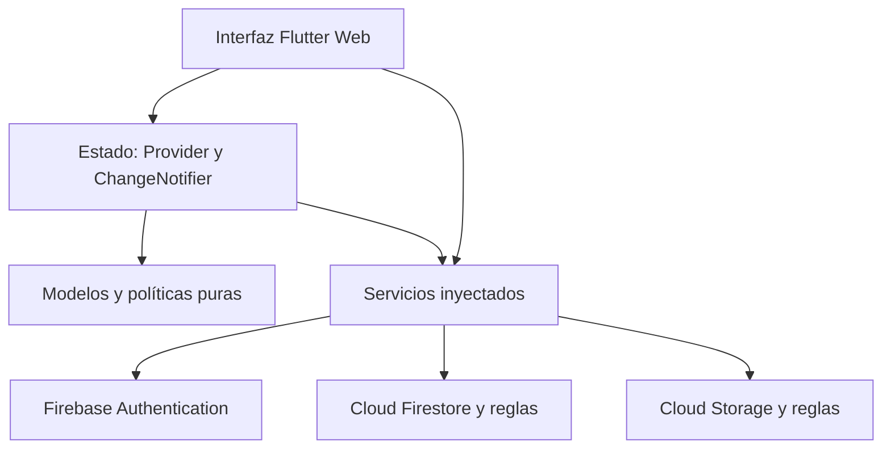

# Arquitectura y modelo de información

## Capas

Las pantallas presentan datos y coordinan interacciones. AuthState mantiene sesión/perfil; IncidentState mantiene suscripción y filtros; IncidentFormState administra envío/error; DashboardState calcula indicadores; ThemeState persiste tema. Los servicios encapsulan acceso al SDK. La política de transiciones es independiente de widgets y Firestore. Firebase Hosting sirve el build web.

Se aplican responsabilidad única y composición mediante inyección de servicios en Provider. No se afirma una arquitectura hexagonal completa: los adaptadores son clases concretas y los modelos reciben mapas del repositorio. La autorización final no depende del estado visual.

## Estructura documental

| Ruta | Campos y significado |
|---|---|
| users/{uid} | name, email, role; identidad coincide con Authentication |
| categories/{id} | name, active; desactivar preserva historial |
| counters/incidents | value, lastId; secuencia atómica |
| incidents/{id} | number, title, description, categoryId, location, priority, status, creatorId, technicianId, revision, createdAt, updatedAt |
| incidents/{id}/events/{revision} | authorId, at, status, technicianId, note, categoryId, priority |
| incidents/{id}/comments/{id} | authorId, at, text, evidence (ruta Storage opcional) |
| Storage: incidents/{id}/{uid}/{archivo} | Binario JPEG/PNG, inmutable desde clientes |

## Correspondencia con el modelo inicial del enunciado

| Enunciado | Implementación |
|---|---|
| id | ID documental de Firestore |
| consecutivo | number y presentación CF-000001 |
| titulo / descripcion | title / description |
| categoriaId / ubicacion / prioridad | categoryId / location / priority |
| estado | status |
| fechaCreacion / fechaActualizacion | createdAt / updatedAt (fecha del servidor) |
| usuarioCreadorId / tecnicoAsignadoId | creatorId / technicianId |
| fotografias[] | comments con evidence; binarios en Storage |
| comentarios[] | subcolección comments |
| historialEstados[] | subcolección events |

Se reemplazan listas crecientes por subcolecciones para no alcanzar el límite de tamaño del documento, evitar sobrescrituras concurrentes y mantener eventos inmutables. Cada comentario contiene como máximo una evidencia; pueden existir muchos comentarios. Esta distribución conserva la información requerida.

## Seguridad e integridad

1. El registro público solo permite crear un perfil con rol reportante y correo del token.
2. Un usuario puede editar su nombre, nunca su rol. Un administrador modifica roles ajenos y no puede degradarse a sí mismo.
3. Firestore verifica al leer que el usuario sea creador, administrador o técnico asignado. Las consultas restringidas permiten evaluar esas condiciones sin utilizar reglas como filtros.
4. Las modificaciones de incidencia solo cambian campos operativos autorizados. No se reescriben creador, título, número ni fecha de creación.
5. Cada cambio incrementa revision y escribe events/{revision}. getAfter verifica que el evento coincide con el documento final. Una escritura sin historial se rechaza.
6. Timestamp del servidor evita falsear fechas; notas, autor, responsable, clasificación y estado se conservan en cada evento.
7. Storage usa permisos de la incidencia, valida tamaño/MIME y bloquea actualización/eliminación. Las imágenes se descargan autenticadas en memoria, limitadas a 5 MiB.
8. No se guarda caché persistente de Firestore en el navegador. Authentication administra su sesión; cerrar sesión desmonta vistas y listeners privados.

Storage y Firestore no ofrecen una transacción común. Primero se crea el reporte, luego se suben/asocian fotografías. Si falla una carga, el reporte se conserva y se informa al usuario para reintentar desde detalle. Una carga completada cuya asociación falla puede quedar huérfana; un administrador del proyecto debe revisar y limpiar esos objetos desde la consola. No se habilita borrado general de evidencias para simplificar esa limpieza.

## Consultas, índices y escala

Reportante consulta por creatorId. Técnico usa OR de creatorId/technicianId. Administrador consulta el conjunto completo. El orden y los filtros se aplican en memoria; no se requieren índices compuestos adicionales para las consultas actuales. Eventos/comentarios se ordenan por at.

La solución prioriza el alcance académico. Un campus con grandes volúmenes necesitaría paginación, búsqueda indexada y agregados de servidor. No se han medido cargas masivas ni tiempos de respuesta. No hay Cloud Functions: negocio se valida en política Dart más Security Rules.

## Manejo de estado y responsabilidades de métodos

| Clase | Método relevante | Responsabilidad |
|---|---|---|
| AuthService | register / ensureProfile | Identidad y creación/recuperación del perfil |
| AuthState | listener authStateChanges | Cambiar sesión y escuchar permisos |
| IncidentService | create | Reservar consecutivo y crear reporte con evento inicial |
| IncidentService | change | Validar revisión, transición y escribir auditoría atómica |
| IncidentService | comment | Registrar seguimiento y ruta de evidencia |
| IncidentPolicy | allowed / validate | Determinar acciones y exigir explicación |
| IncidentState | filtered | Intersección de búsqueda y filtros |
| DashboardState | open / byCategory | Agregación de indicadores |
| EvidenceService | upload / load | Validación y transferencia autenticada de fotografías |
| ThemeState | toggle | Preferencia de tema |
